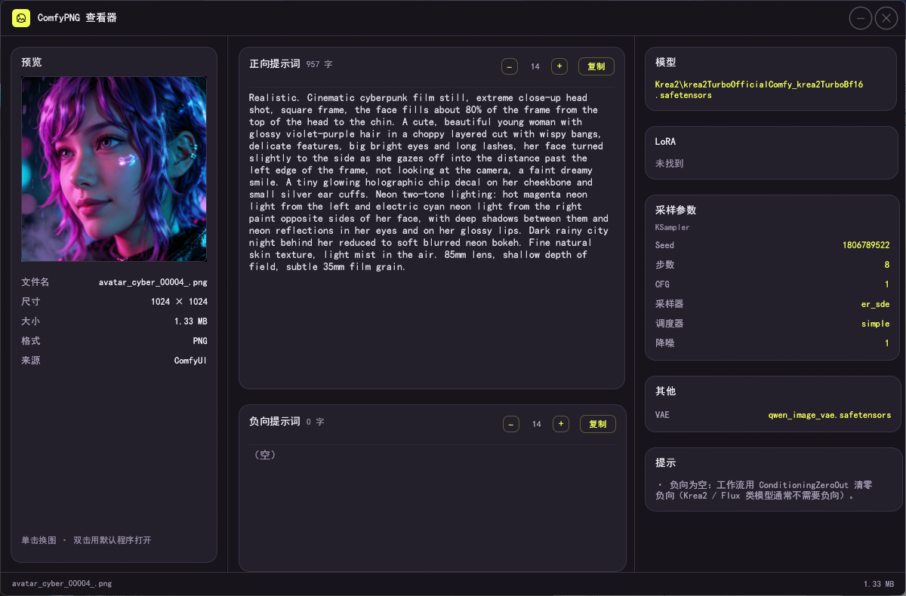
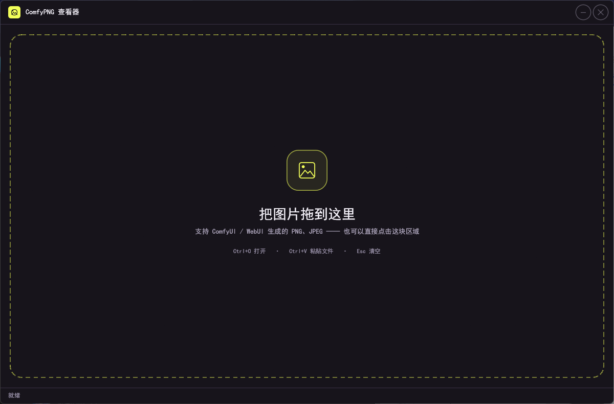

# ComfyPNG Viewer

[](LICENSE)
[](#requirements)

**English** | [简体中文](README.zh-CN.md)

A small, fast Windows viewer for the generation metadata inside ComfyUI and
Automatic1111 / WebUI images. Drop an image in and see the prompts, model,
LoRAs and sampler settings at a glance — no browser, no Python, no server.



## Features

- **Open however you like** — drag & drop, `Ctrl+O`, `Ctrl+V` (a file copied in
  Explorer), or `ComfyPNG.exe "C:\path\image.png"`.
- **ComfyUI node graph** — KSampler / KSamplerAdvanced / SamplerCustom(Advanced),
  the Flux guider chain, rgthree Power Lora Loader, CR text concatenation,
  ConditioningZeroOut, multi-sampler (hires-fix) workflows.
- **Custom nodes** — Impact Pack wildcard nodes (`ImpactWildcardEncode`),
  `Image Saver` nodes, and seeds / CFG / steps routed through literal nodes.
  When the graph hides a value, the A1111 `parameters` block in the same PNG
  fills the gap (graph values always win).
- **Automatic1111 / WebUI** — the `parameters` block in a PNG text chunk or in a
  JPEG `UserComment`, including `<lora:name:weight>` tags.
- **Copy anything** — click a model, seed, sampler or LoRA value to copy it.
- **Readable dark UI** — frameless window with a compact title bar, remembered
  size and position, adjustable prompt text size.
- **Fast** — only PNG chunks / JPEG headers are read; pixels are decoded once for
  the thumbnail.



## Requirements

Windows 10 / 11 (x64). No installer and no runtime — the executable is a single
5.5 MB file.

## Download

Grab the latest `ComfyPNG.exe` from the
[Releases](https://github.com/ibelwang/comfy-png-inspector/releases) page.

## Usage

| Action | How |
| --- | --- |
| Open an image | drag & drop, click the dashed area (when empty), `Ctrl+O`, or pass a path on the command line |
| Paste a file | `Ctrl+V` |
| Clear | `Esc` |
| Copy a parameter | click its value |
| Copy a prompt | the copy button next to the prompt |
| Change prompt text size | `−` / `+` next to the copy button (10–24 pt, remembered) |
| Open the original file | double-click the preview |
| Choose another image | single-click the preview |

## Build from source

```powershell
cargo build --release
```

Requires a stable Rust toolchain with the MSVC linker. The result is
`target\release\comfy-png-inspector.exe`.

`build.rs` embeds `assets/icon.ico` into the executable using the Windows SDK
resource compiler (`rc.exe`). If it is missing the build still succeeds — only
the file icon is omitted.

Run the parser tests with:

```powershell
cargo test
```

## What metadata is supported

| Source | Read from | Extracted |
| --- | --- | --- |
| ComfyUI | `prompt` tEXt / iTXt chunk (zlib-compressed iTXt included) | prompts (through the sampler graph), checkpoint / UNET, LoRAs + strengths, VAE, clip skip, sampler, scheduler, seed, steps, CFG, denoise |
| A1111 / WebUI | `parameters` PNG text chunk, or JPEG EXIF `UserComment` | prompt, negative prompt, sampler, scheduler, steps, CFG, seed, size, model, clip skip, `<lora:name:weight>` tags |

If an image carries no metadata the viewer says so instead of guessing.

## Privacy

Everything runs locally. The application makes no network requests; the only
thing it writes is a small `settings.json` in `%LOCALAPPDATA%\ComfyPNG`.

## License

MIT — see [LICENSE](LICENSE).

## Acknowledgements

- The dark palette is inspired by the [ComfyUI](https://comfy.org) website.
- This is an unofficial tool; it is not affiliated with or endorsed by ComfyUI
  or Automatic1111.
